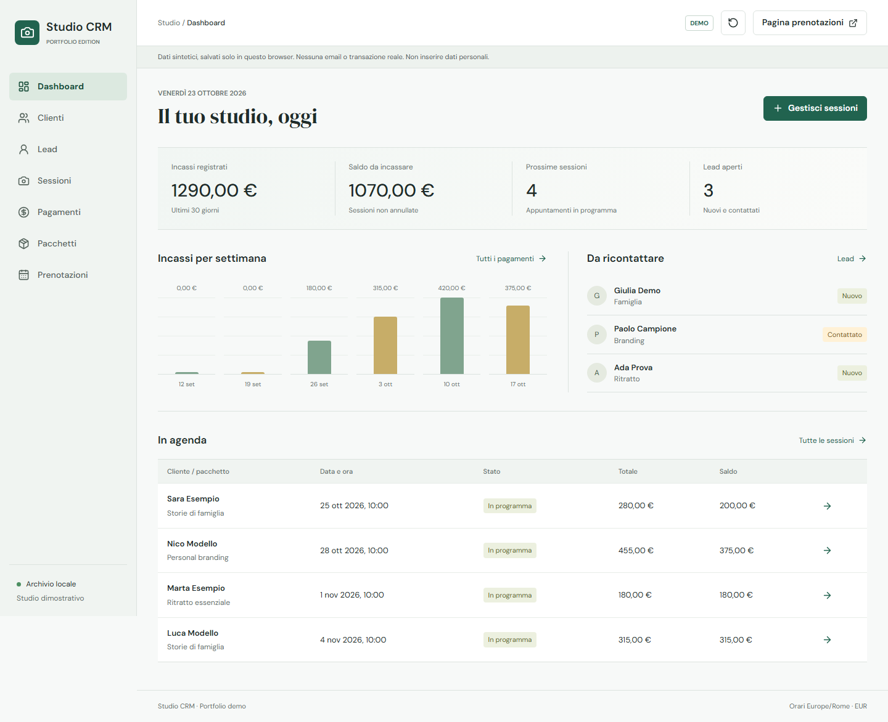
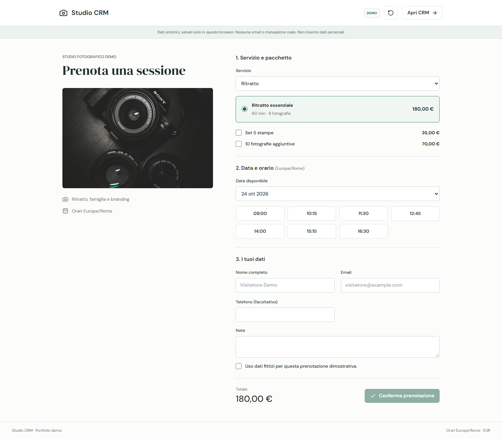

# Studio CRM Demo

A standalone portfolio edition of a photography studio CRM. All business data
is synthetic and all changes stay in the visitor's browser. No credentials,
database server, authentication service, email provider or payment gateway are
required. The interface is in Italian; scheduling uses Europe/Rome and EUR.

**Local implementation only. Nothing has been deployed or published.**



## Case Study

A booking tool can reserve a time slot while leaving the studio to recreate
contacts, service details and balances elsewhere. This demo brings that handoff
into the CRM: selecting a package and an available slot creates the client and
session together. The same calendar also governs sessions created by staff and
through lead conversion.

The portfolio adaptation replaces the private application's backend and
integrations with a small, transactional browser-local domain. The original
availability engine is retained; production API routes, authentication,
database migrations, synchronization clients and email delivery code are removed.
This is a demonstrable workflow, not evidence of measured business outcomes.

## Try the Workflows

1. Open `/` for the explicitly labeled demo dashboard. No login is needed.
2. Open `/prenota/studio`, select a service, package, optional extras and a slot.
   Use a fictional name and an `example.com` email address, then confirm.
3. Follow the confirmation to the CRM session, or inspect `/prenotazioni` in
   another tab in the same browser. The client and session appear automatically.
4. Record a partial payment on the session. Its balance and dashboard totals
   change; no money moves and no message is sent.
5. Alternatively, create a lead at `/leads` and convert it into a session, or
   create a client at `/clients` and add a session from their profile.
6. Use the reset icon in the header to restore synthetic data across all tabs.

Packages include a price, duration and photograph count. Optional extras are
copied into the session alongside the package, so later catalog edits do not
rewrite existing prices or durations. Existing clients are matched by normalized
email when booking or converting a lead.

Booking settings cover weekdays, opening hours, closed dates, minimum notice,
buffer time and a rolling booking horizon. All services share one studio
calendar. Availability is recalculated inside the save transaction, preventing
overlapping submissions even from stale tabs. Cancelling a session frees its
slot; recorded payments must be reversed before cancellation.



Mobile captures: [dashboard](docs/screenshots/dashboard-mobile.png) and
[booking](docs/screenshots/booking-mobile.png).

## Architecture

```text
Next.js pages / React client views
                 |
            DemoProvider
                 |
     IndexedDB read-write transaction
       read latest -> validate -> write
                 |
      BroadcastChannel -> other tabs
```

- `lib/demo.ts`: deterministic relative-date seed, typed commands, financial
  calculations, contact matching and atomic business rules.
- `lib/booking.ts` and `lib/datetime.ts`: availability and Europe/Rome conversion.
- `lib/demo-store.ts`: one versioned state record in IndexedDB database
  `studio-crm-portfolio`, object store `demo`, key `visitor-state`.
- `components/demo/`: provider, forms, public booking and CRM views.
- `app/[...path]/page.tsx`: allowlisted demo routes. Removed integrations and
  application API URLs return 404 rather than silently returning mock success.

IndexedDB serializes read-write transactions on the store, including across
tabs. A failed validation aborts the transaction before any client, lead or
session changes are persisted. BroadcastChannel refreshes other tabs; returning
focus also refreshes state. There is no mutable server-side business state and
no business-data HTTP request. Fonts and the photograph are served locally.

## Setup

Use Node.js 22 or newer and npm. No `.env` file is needed or expected.

```sh
npm ci
npm run dev -- --hostname 127.0.0.1 --port 3100
```

Open http://127.0.0.1:3100. Choose a different free port if necessary. For a
production-mode local preview, run `npm run build` and then `npm run start`.
Never copy production credentials into this project.

## Verification

Verified locally on 2026-10-23: 6 domain tests and 16 Chromium browser tests
passed, along with ESLint and the production build. Browser tests ran against
the production build on both desktop and mobile viewports.

```sh
npm test
npm run lint
npm run build
npm run test:browser-install
npm run test:e2e
npm audit --omit=dev
```

The browser installer writes only under `node_modules/.cache/ms-playwright`.
The Playwright suite uses port 3100 and starts a production preview from the
existing build when that port is free. Close any unrelated server on that port
before running it; a running local demo can be reused outside CI.

Domain tests cover atomic booking, cross-service overlap and buffers, closed
days, lead conversion, email matching, payment boundaries, cancellation and
immutable package snapshots. Browser tests exercise both portfolio journeys,
profile editing, reload persistence, isolated browser contexts, cross-tab reset,
concurrent bookings, closed days, payment reversals and unavailable storage.
They also check removed routes, external requests, assets and page overflow at
1440 x 1000 and 390 x 844. Screenshots above are generated from the running demo.

The production dependency audit is clean as of 2026-10-23. The full npm audit
still reports five high-severity entries in the development-only
`eslint-config-next -> @next/eslint-plugin-next -> fast-glob -> micromatch -> braces`
chain. npm's proposed fix downgrades the Next lint configuration to version 14;
it was not applied because this app uses Next 16. Recheck upstream before release.

## Boundaries

- Isolation is per origin and browser profile, not per authenticated person.
  Tabs in the same profile share changes. Different browsers, profiles, devices
  or origins have independent data and independent availability.
- There is no real multi-user booking service. Sharing a booking URL does not
  share a calendar or deliver bookings to another person's CRM.
- Data persists until reset, browser cleanup or storage eviction. Private mode
  may discard it on exit. There is no cloud backup or cross-device sync.
- IndexedDB must be enabled. Storage failures are shown explicitly; writes do
  not fall back to a shared server or claim success without persistence.
- Dates are relative to the day the seed is created or reset, not automatically
  shifted on every visit. Reset an old demo to refresh its example timeline.
- Payments are records only. Reversing one is not a real refund. There are no
  emails, SMS, calendar invitations, captcha, tracking or payment processing.
- Public and internal session creation use the same availability settings.
  Sessions can be created, completed or cancelled; rescheduling requires
  cancelling and recreating. Extra products are a fixed demo catalog.
- Chromium desktop and mobile emulation are covered. Safari, Firefox, real
  mobile devices and assistive-technology certification are not yet verified.
- This is not an offline-installed PWA, an accounting system or a secure place
  for personal data. Enter fictional information only.

## Assets and Publication

The name "Studio CRM", sample contacts and `example.com` addresses are fictional.
No customer photos, original environment files, private migrations or production
service clients remain in the demo. The original repository is not a dependency.

The local camera photograph comes from
[Unsplash's source image](https://images.unsplash.com/photo-1516035069371-29a1b244cc32)
under the [Unsplash License](https://unsplash.com/license). It is illustrative,
not a photograph of the original studio. DM Sans and DM Serif Display are
self-hosted through Fontsource under their SIL Open Font Licenses; icons are
from Lucide under the ISC license. No license for the inherited application
source is granted by this README.

Before publication, confirm the right to publish inherited source and the
chosen assets, recheck the dependency advisories, then review a separate preview
deployment without any production secrets. Repository creation, commits and
deployment are intentionally outside this implementation.